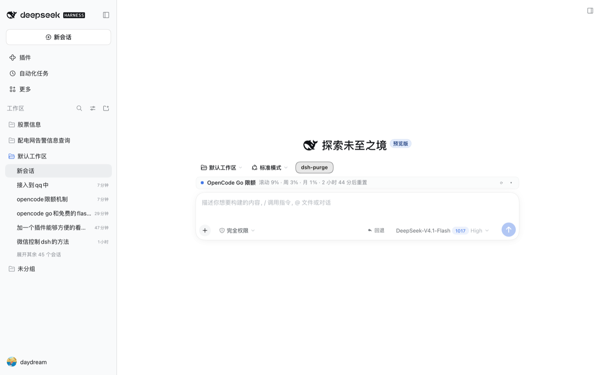
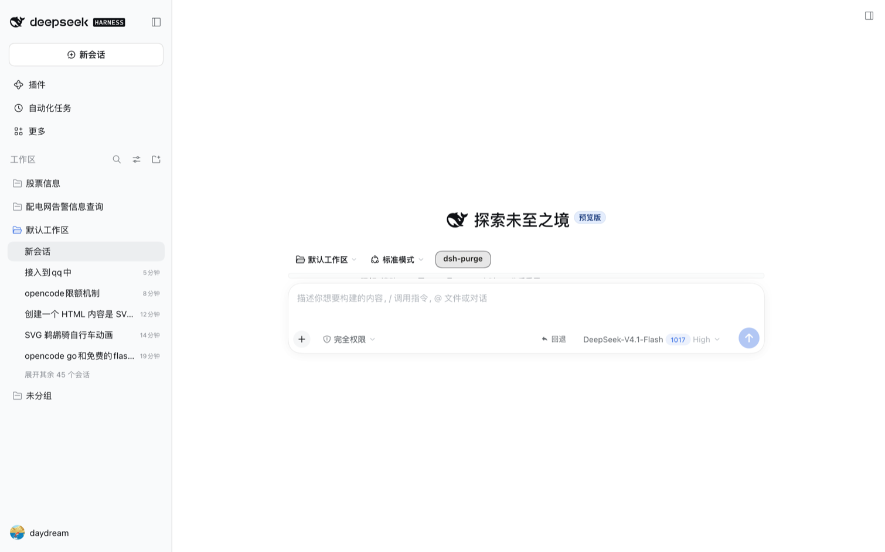
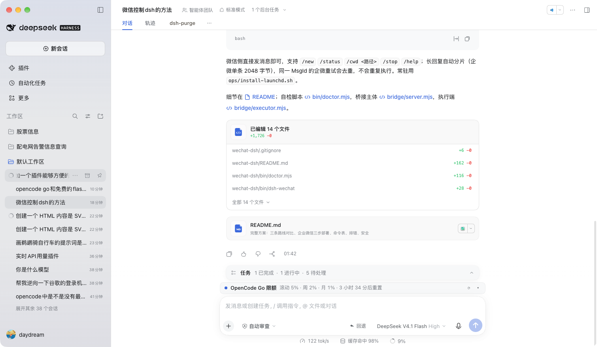

# dsh-opencode-go-usage

[](https://github.com/daydream-wjh/dsh-opencode-go-usage/actions/workflows/test.yml)

一个 [DeepSeek Harness](https://github.com/deepseek-ai/deepseek-harness)（DSH）插件：在输入框上方常驻一行 **OpenCode Go 套餐限额读数**——滚动窗口 / 本周 / 本月三条额度用了多少，以及最近一次重置还剩多久。


## 它显示什么

收起状态（一行）：

```
● OpenCode Go 限额   滚动 4% · 周 1% · 月 0% · 3 小时 39 分后重置        ⟳  ▾
```

- 三个数字是套餐的三条窗口：`滚动`（rolling）、`周`、`月`，取自提供方
  `GET https://opencode.ai/zen/go/v1/usage` 的 `percent` 字段。
- 倒计时是**最近一个**要重置的窗口（通常是滚动窗口）。
- 圆点取三条窗口里最高的那条：`< 70%` 正常色，`≥ 70%` 警告色，`≥ 100%` 错误色。
- `⟳` 立即重读（`?force=1`，跳过宿主 20 秒缓存）；`▾` 展开明细，展开状态记在
  `localStorage: dsh.opencode-go-usage.expanded`。

展开状态：

| 行 | 内容 |
|---|---|
| 滚动窗口 / 本周 / 本月 | 百分比、进度条、`x 天 y 小时后重置`（悬停看具体时刻） |
| 页脚 | 提供方上报的 `status`（正常 / 接近上限 / 已用尽…）、上次读数时间 |

未配置 `OPENCODE_GO_API_KEY` 时只显示一行灰字提示，不占位；读取失败（网络、上游 5xx）
显示错误原因，下一次轮询自动重试。

### 新对话页

新建对话时输入框居中放大（hero 布局），这一行仍然贴在输入框上沿、与输入框同宽同边：



这里是它唯一需要额外小心的地方：hero 下的输入框栈（`composerStack` + `composerHero`）是一个
**高度被收窄**的 flex 列，标题区先吃掉整列高度，其余子项按 `flex-shrink` 分剩下的空间。
本插件的行默认 `flex-shrink: 1`，再加上 `overflow: hidden` 会把 `min-height: auto` 折算成 0，
于是被压成 9px 的细条、文字裁掉半截：



修法是让这一行退出收缩（`flex: 0 0 auto`），保住自身高度，把溢出交给 hero 列自己滚动：

| 实测（1440×900，DSH 0.2.1-rc.3） | 修复前 | 修复后 |
|---|---|---|
| 行高（收起） | 9px，`scrollHeight` 30px，内容被裁 | 30px，无裁切 |
| 行高（展开三条窗口） | 同样被压缩 | 130px，三行完整 |
| 与输入框的横向对齐 | 774px，左边缘对齐 | 774px，左边缘对齐（不变） |

未配置 Key 的那行灰字走同一个根节点样式，也一并钉住了；`verify/client.test.mjs`
里有一条回归用例守住这个 `flex`。


## 为什么分两半

| 半边 | 文件 | 职责 |
|---|---|---|
| 宿主 | `lib/index.js` | 从 `ctx.credentials` 解析 `OPENCODE_GO_API_KEY`，请求上游用量接口，归一化成三窗口，缓存 20 秒，注册 `GET /opencode-go/usage` |
| 客户端 | `lib/client.js` | 只读宿主路由并渲染；不碰 Key，不跨域请求 opencode.ai |

上游用量接口要账号 Key，而 Key 只存在于 `.credentials.yaml`，浏览器脚本里不该出现。
路由挂在和内置 Web 路由同一道 `connection` 信任围栏后面，只有本机已认证的页面能读。

路由契约：

```
GET /opencode-go/usage            → { ok: true, windows: { rolling, weekly, monthly }, fetchedAt }
GET /opencode-go/usage?force=1    → 同上，跳过缓存
命中缓存                          → 上一次的载荷 + { cached: true }（只需知道读数没变，不带新的 fetchedAt）
未配置 Key                        → { ok: false, code: "no-key", message }
Key 失效                          → { ok: false, code: "auth", message }
上游失败 / 超时 / 结构不认识      → { ok: false, code: "upstream" | "timeout" | "network" | "payload", message }
```

失败一律 200 + `ok:false`：对一个读数组件来说「这次没读到」是常态，不是 HTTP 错误层。
只有信任围栏（401/403）和方法（405，`Allow: GET, HEAD`）走 HTTP 语义。

### 一次读数的生命周期

1. 客户端挂载时读一次；之后每 60 秒（`POLL_MS`）读一次，页面切到后台就跳过这一轮，
   切回来时若距上次读已超过 60 秒则立刻补一次。
2. 倒计时不靠网络刷新：客户端每 30 秒（`TICK_MS`）重算一次，所以「3 小时 39 分后重置」
   会自己往下走。
3. 宿主侧 20 秒内命中缓存直接回，不再打上游；`?force=1` 跳过缓存。
4. 并发读合并：同一时刻多个轮询共用同一个上游请求（`inflight`），不会打成一串。
5. **只有成功的读数进缓存**：失败（超时、5xx、Key 失效）不缓存，下一次轮询就会重试，
   不会让一次抖动把组件按在错误态整整 20 秒。

## 安装

### 1. 准备 OpenCode Go 的 Key

在 [OpenCode Console](https://opencode.ai/console) 订阅 Go / Go Plus 并复制 API Key，然后写进 DSH 的凭据存储：

```sh
# 凭据名固定为 OPENCODE_GO_API_KEY
# 用 DSH 的凭据命令写入，或直接编辑 ~/.dsh/.credentials.yaml
```

解析顺序是**先凭据库、后启动环境**：宿主先用 `ctx.get('credentials').resolve('OPENCODE_GO_API_KEY')`，
取不到再退回 `ctx.get('launchEnvironment').get('OPENCODE_GO_API_KEY')`。
所以不想动 `.credentials.yaml` 的话，在启动 DSH 之前 `export OPENCODE_GO_API_KEY=...` 同样有效
（桌面版从 Dock 启动时拿不到 shell 的 export，这种情况还是写凭据库）。

本插件只读 `OPENCODE_GO_API_KEY`，不读写你的 OpenCode 配置文件。

### 2. 放进 profile 的本地插件目录

```sh
git clone https://github.com/daydream-wjh/dsh-opencode-go-usage.git \
  ~/.dsh/profiles/desktop/local-plugins/opencode-go-usage
```

### 3. 在 patch 层登记宿主入口

编辑 `~/.dsh/profiles/desktop/cordis.patch.yml`，追加：

```yaml
- insert:
    - id: opencode-go-usage
      name: './local-plugins/opencode-go-usage/lib/index.js'
```

HMR 会自动重组，不用重启 DSH。客户端半边通过 `package.json` 的
`dsh.client.platform: "web"` + `exports["./client"]` 被 `client-modules` 发现并作为
浏览器 bundle 下发。

### 装好之后

输入框上方应该出现这样一行（收起状态）：



如果那里只有一句灰色「OpenCode Go 限额 · 未配置 OPENCODE_GO_API_KEY」，说明第 3 步已生效、
只是第 1 步的 Key 还没写进去——这时点 `⟳` 也读不出来，回去把 Key 补上即可。

### 卸载

删掉 patch 层里那一段即可；插件不做任何持久化写入（除 `localStorage` 里的展开状态）。

## 配置（可选）

`apply(ctx, config)` 认两个数字，都有默认值：

| 键 | 默认 | 含义 |
|---|---|---|
| `cacheMs` | `20000` | 同一读数在宿主缓存多久 |
| `timeoutMs` | `8000` | 上游请求预算，超时回 `code: "timeout"` |

## 验证

```sh
node --test verify/route.test.mjs verify/client.test.mjs
```

- `verify/route.test.mjs`：用假 `fetch`、假 Cordis 上下文、假 `ServerResponse` 驱动真实宿主半边——
  窗口归一化、401/5xx/超时/脏结构的错误映射、缓存与 `force=1`、缺 Key、信任围栏与方法守卫。
- `verify/client.test.mjs`：把真实 `lib/client.js` 放进假 `window` / 假 React 里跑，
  检查成功 / 失败 / 未配置 Key 三种渲染、摘要文本、三条明细行和格式化函数，以及根节点必须带
  `flex: 0 0 auto`（新对话页被压扁的那次回归）。

上面两条都不画像素，所以新对话页的布局是拿无头 Chrome 走 CDP 量的：在 `web` profile 里加载
真实宿主页面，读 `[data-dsh-opencode-go-usage]` 的 `clientHeight` / `scrollHeight` 判断有没有被裁，
再和输入框卡片 `[class*="_card"]` 的 `getBoundingClientRect()` 比宽度和左边缘。

## 兼容性

- 目标：DeepSeek Harness 桌面版，`web` 平台客户端插件。
- 宿主半边用到的服务：`webServer`、`connection`（`inject` 声明的必需项），以及按需读取、
  缺失也不报错的 `credentials` / `launchEnvironment`。
- 上游：OpenCode Go 网关（`https://opencode.ai/zen/go`），用量接口未公开文档化，字段若有变动
  会归到 `code: "payload"`，不会崩溃。

## License

MIT
